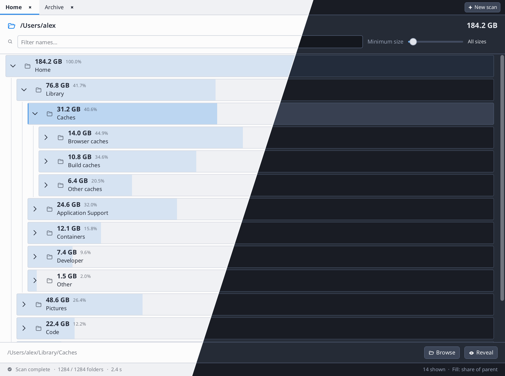

# dir_weight

Disk-usage explorer: scan a directory tree and find what is taking the space.
The interface follows the system light or dark appearance.



## Disk usage tree

Pick a folder or pass one on the command line. Scanning runs in the background.
Each node keeps its size directly above its name, with indentation and guides
showing the folder hierarchy. The background fill and nearby percentage show
that entry's share of its parent.

- Use the chevron to expand or collapse a folder.
- Select an entry to see its full path and use **Browse** or **Reveal** below the tree.
- Select a folder and choose **Rescan folder** to refresh that subtree, or use
  **Rescan all** to refresh the tab's root. Results stay visible while scanning.
  Sizes, ordering, percentages, and skipped-folder details update on completion;
  filters and surviving folders' expansion and selection stay in place.
  Other folders keep their previous measurements until rescanned. Results are
  snapshots; use the rescan controls to refresh measurements after files change.
- Use **Minimum size** to hide small entries. The name filter searches descendants
  even inside collapsed folders and presents matches in descending size order.
  In filtered results, fills represent each entry's share of the summed result
  sizes; matching parents and children can overlap.
- Open several scans in tabs. Each keeps its filter, expansion, selection, and
  scroll position. Closing a tab cancels its scan.
- Read scan progress, folder counts, elapsed time, and the visible entry count
  in the bottom status bar. Inaccessible subfolders appear as a neutral skipped
  count; select it to inspect or copy the paths and reasons.

## Review and delete

Select a file or folder below the scan root and choose **Queue for deletion**.
Queued rows remain visible, and queueing does not change files or sizes. A queued
folder covers its scanned descendants; overlapping selections count once.

**Review deletions…** shows the queued paths and their measured sizes. **Restore**
or **Restore all** removes items from the queue without touching disk. **Back to
scan** preserves the queue. **Delete N permanently** executes deletion; it cannot
be undone. Closing a tab with queued items asks whether to discard the queue.

Deletion runs in the background with a removed-item count and elapsed time.
You can browse, filter, and switch tabs while it runs. **View progress…** reopens
the list; **Back to scan** or Escape dismisses it without interrupting deletion.
Rescanning, queue changes, and closing the deleting tab wait until it finishes.
Failures stay queued with a status message so you can review them when ready.

Successful removals immediately update the stored tree, ancestor totals, ordering,
percentage bars, and hard-link ownership **without rescanning**. Known removals
also update overlapping scan tabs; a busy tab applies them when its operation
finishes. Other measurements retain their stored values. Queue sizes describe
measured allocation, not guaranteed recovered disk space.

Deletion checks recorded identities and file metadata before removing entries.
Replaced or modified items remain queued with an error. Folder deletion processes
only scanned entries: additional unscanned files leave the directory nonempty.
Successful partial removals are deducted; failed items stay available for review,
restore, or retry. Rescan a changed folder manually to review its current contents.
Symlinks are removed as links. The scan root itself cannot be queued.

## Shared tabs

`TabStrip`, `TabItem`, and `TabCloseButton` in `shirei/widgets` provide the same
flat tabs used by Haystack. The application owns tab order and selection and
applies close requests after rendering the strip. Their `Styled` variants accept
literal colors through `TabStyle`; the ordinary functions resolve the current
color scheme.

## Tree rendering

Visible entries are collected into a flat slice (`ListupViewableEntries`) and
rendered by `VirtualListViewExt` at a fixed row height. Expanding a folder changes
that slice; it does not create nested scroll views. Only visible rows are built.

`SizeTreeRow` draws the size fill as a floating `Element` with `Behind`, using a
fraction of the row's resolved width. Labels retain the full row width, so small
entries remain readable. Indentation is capped to leave room for names in deep
trees. Fills, guides, text, and selection use the current color scheme.

## Background scan under the frame lock

Workers read the filesystem outside the UI thread (`buildDirDraft`) into a
private list of children. They attach that list, update counters, and roll sizes
under `WithFrameLock` (`publishDirDraft` → `updateSizeAndStateAndSorting`).
Closing a tab sets an atomic cancel flag so in-flight jobs never promote the
scanner to `Done`. Hard links use atomic `LoadOrStore`; directory cycles are
blocked via `seenDirs` and skipping symlink-like modes.

Rescans build a separate tree and publish it into the existing tab on completion.
The combined tree reconciles stored file identities so hard links across the
rescan boundary count once, including when one name disappears. Fresh allocation
sizes also update other known names for the same file. A missing subfolder is
removed; an unreadable folder contributes no contents and appears in scan details.

## Run it

From the repository root:

```shell
go run ./shirei/examples/dir_weight
go run ./shirei/examples/dir_weight ~/Library ~/Downloads
go run ./shirei/examples/dir_weight -png out.png ~/Downloads
```

To run independently of other modules listed in the repository's `go.work`:

```shell
cd shirei/examples/dir_weight
GOWORK=off go run .
```
