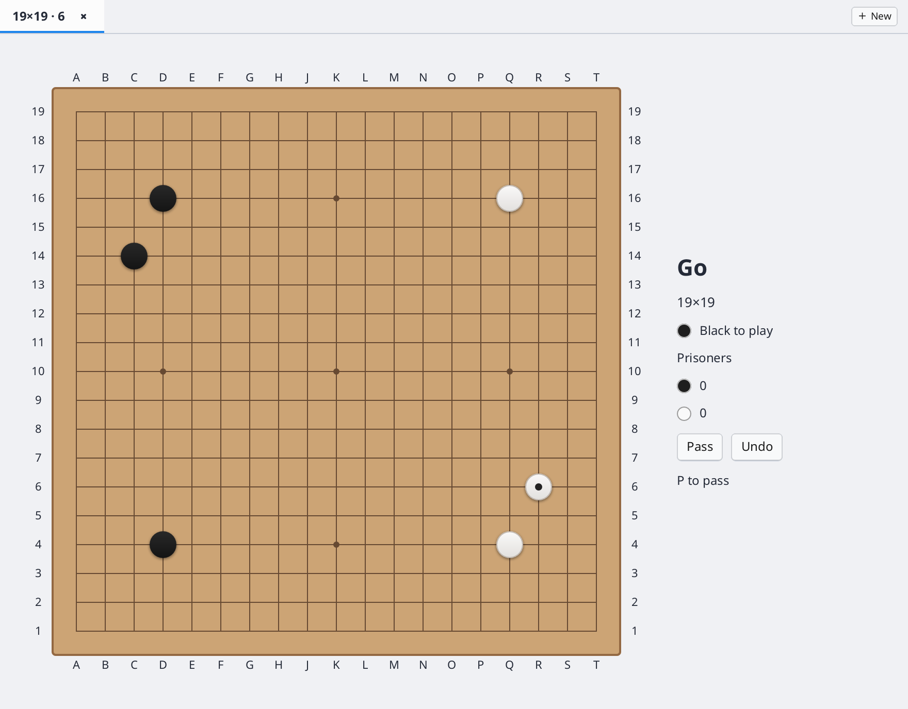

# Go

A board for the game of Go.



Click an empty intersection. Black plays first. P passes. Undo is ⌘Z on macOS
and Ctrl+Z elsewhere, or the Undo button.

Each tab is one game. New asks for 9×9, 13×13, or 19×19, then opens that
board. The size stays for the life of the tab. Closing the last tab leaves
an empty window until the next game.

The board fills the square beside the side panel. A smaller grid uses a
larger pitch in that same square. The pitch stays at least 28, and a window
smaller than that scrolls.

Columns run from A through T, skipping I. Rows are numbered from the bottom.

A stone goes on an empty intersection. A group with no liberties is captured.
A move that takes your own group's last liberty is illegal, unless it captures.
Ko rejects a move whose resulting layout is the layout from before the previous
move. A pass clears that restriction. Prisoners count the stones each color
has taken.

There is no scoring and no game-file loading.

The board stays wood-colored when the rest of the window follows light or dark mode.

```bash
go run .
go run . -png out.png
```
