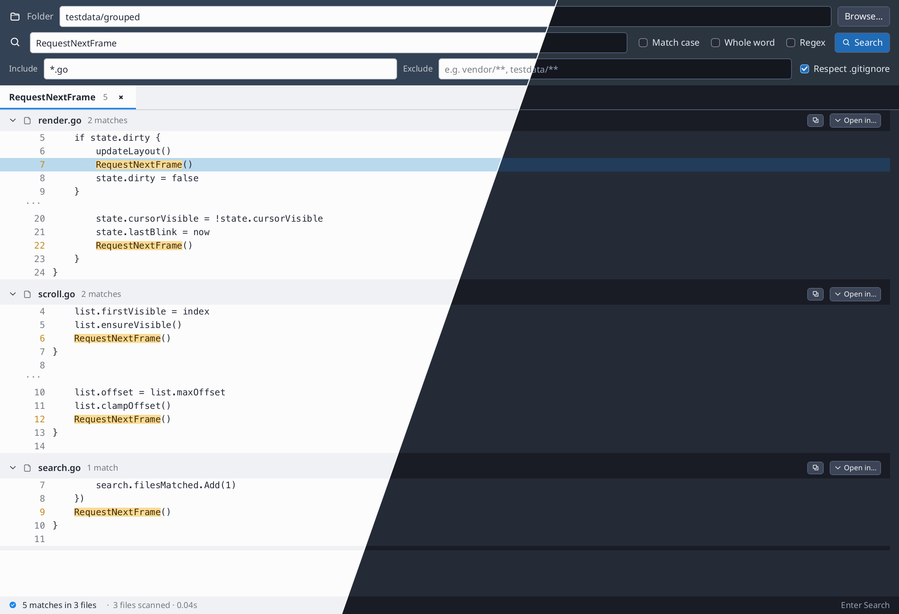

# haystack

Search for text across a directory tree; matches stream into a compact native UI
that follows the system light or dark appearance.



## Find in files

Choose a folder, enter a query, and press Enter or Search. Literal search supports
case matching and whole words; Regex enables regular expressions. Include and
exclude globs narrow the files, with optional `.gitignore` handling.

- Each search stays in its own tab. Selecting a tab restores its query, filters,
  selection, collapsed files, and scroll position.
- Results share one header per file. Click a header to collapse or expand its
  snippets; matching text is highlighted in amber.
- Click a code line to select it. **Edit** opens the file at that line inside
  Haystack; double-clicking a code line opens it directly. With no line selected,
  Edit opens the first match. **Open in…** opens an installed external editor
  (VS Code, Sublime, or Zed). The copy button copies the file path.
- Cmd+F / Ctrl+F focuses the search field. Enter in the query or glob fields runs
  a new search.
- The footer reports matches, files hit/scanned, and elapsed time.

Matching uses [`go.hasen.dev/textsearch`](../../../textsearch), a pure-Go engine
with no `rg` or `grep` subprocess.

## Edit files

File tabs keep their documents, selections, and undo histories while you switch
between files and search results. Cmd/Ctrl+S or **Save** writes the active file.
Closing a modified tab offers Save, Discard, and Cancel. **Save copy…** writes
to a new path and switches the tab to that file. Existing destinations are
protected. Search results are snapshots; run Search again to see saved changes.

The editor accepts regular UTF-8 text files up to 32 MiB. It preserves LF/CRLF
line endings and permission bits, detects conflicting disk contents, and writes
through a temporary file before replacing the destination. Normal close/quit
records unsaved buffers in `shirei-haystack/editor-drafts.json` under the user's
cache directory; the next launch restores them. `HAYSTACK_RECOVERY_PATH` selects
another recovery file for isolated sessions and tests.

The [editor API documentation](../../docs/text-editor.md) describes storage,
navigation, file-save limits, and recovery scope.

## Streaming and virtualization

The worker pool scans files in the background. Each complete file's matches are
published under `WithFrameLock`, followed by a redraw request. Counters are
atomic. The frame path reads a consistent snapshot and keeps the live status
updated while a search runs (`search.go`, `StatusLine`).

`appendResultRows` transforms newly published files into a flat sequence of file
headers, code lines, and snippet separators. It references the engine's `Match`
and `ContextLine` data without copying source text. Collapsing a file rebuilds
this display sequence with that file's code omitted.

`VirtualListViewExt` builds only visible rows, even when one file has a large
contiguous match block. Fixed row heights keep scrolling independent of source
line length. The list is keyed by `*Search`; each tab saves its first visible row
and restores it on activation (`gui.go`).

## Run it

```shell
go run .                              # inside examples/haystack
go run . -query RequestNextFrame ../../widgets
go run . -query hello -png out.png testdata/sample
go run . -edit path/to/file.go -line 42
```

More Shirei concepts: [tutorial.md](../../docs/tutorial.md).
