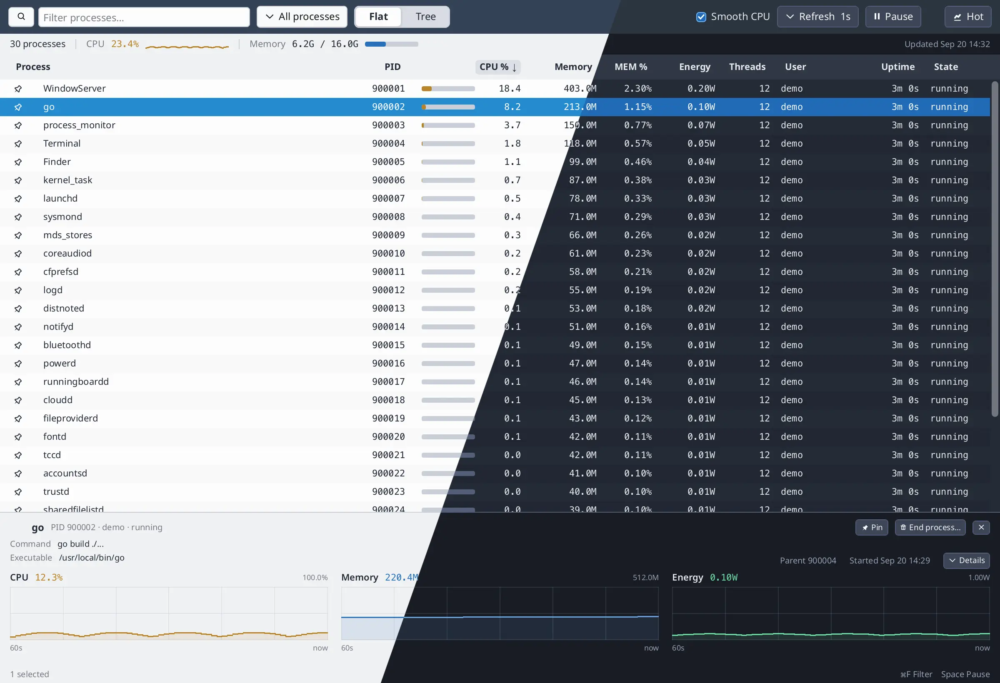
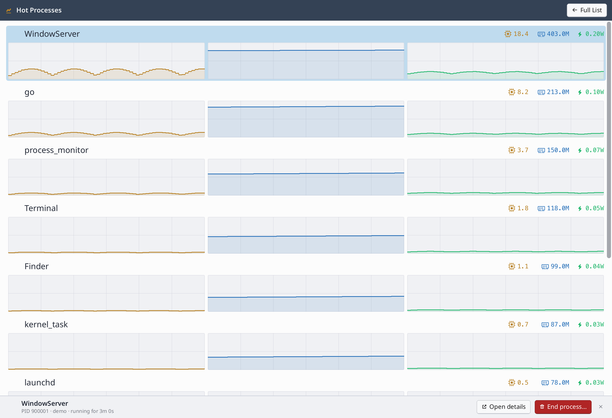

# process_monitor

A small task manager: live process list, filter, tree or flat table, host
CPU/memory, and per-process CPU/memory/energy history. The compact layout follows the system
light or dark appearance.



## Live process list and history charts

Shows processes for the current machine with columns for PID, CPU, RSS, memory
share, uptime, power (when the OS can measure it), user, state, threads, and
name (with the program icon when the OS provides one). Click a column header to sort
(again to reverse). Select a row for a compact bottom inspector with command, executable, parent,
start time, and ~60s CPU/memory/energy charts. The Details menu includes the working
directory. Click the row again or × in the inspector to close it.

- The filter stays visible: search name, command line, user, or PID. ⌘F / Ctrl+F
  focuses it; Esc or × clears it
- Scope the list to all processes, running processes, or pinned processes
- Pin a process (icon on the name, or Pin in the details panel) to keep it
  at the top of the sort — including among tree siblings — and after it exits
- End the selected process (confirm the second click); permission errors
  surface as a toast
- Flat list or parent/child tree (collapse with ▸/▾; filter keeps ancestors)
- Refresh every 1s / 2s / 5s / 10s
- Smooth CPU (on by default) filters the CPU column and its row order over
  ~3s so rows do not reshuffle on every sample; the history charts keep the
  raw samples
- High-CPU alerts: when the app is not focused, a floating popup lists
  processes that stay above ~60% for ~4s. A row is removed once its process
  stays below ~30% for ~2s; rows are kept while the pointer is over the popup,
  and the popup closes when the list is empty. Click a process to select it,
  clear the filter, and bring the main window forward, or click Dismiss to close
  the alert without activating the monitor. A dismissed process is not alerted
  again until it restarts. The popup does not take focus; stacking follows
  desktop policy on Wayland and X11
- Hot mode: start with `-hot` or press Hot in the toolbar to switch the main
  window to a top-10 CPU dashboard with icon-labeled CPU/memory/power values and
  60s charts per process. The hot list always samples every 1s with smoothed CPU,
  independent of the full-list controls. Click a row for a bottom panel with its
  uptime and Open details / End process actions. Full List returns to the table.
  High-CPU alerts behave as usual in either mode
- Pause/resume sampling with the toolbar button or Space when no control has focus.
  Filtering, sorting, and inspecting remain available while paused
- Metrics that could not be read show `--`, not a fake zero (power is
  best-effort: macOS task energy, Linux RAPL share when readable)
- Exited processes stay for ~10s (and while selected) and render faded as "exited"
- Same UI on macOS, Linux, and Windows (`procinfo` collectors underneath)



There is also a headless terminal mode (`-once`) that prints a sorted report
and exits — useful for quick checks without opening a window. Start in the Hot
Processes dashboard with `-hot`.

## Chart from containers

A small “chart” built only from ordinary containers — no canvas widget, no
chart library. Related: [tutorial.md](../../docs/tutorial.md) Part IV.

`UsageChart` plots a minute of history as a thin step line with a faint area fill.
`historyPlot` places horizontal segments and vertical connectors using `Float`
and `FixSize` inside a clipped container. The grid uses the same primitives.
Metric labels and adaptive scale limits sit above each chart; time labels sit
below. Empty leading slots remain blank.

History is irregularly sampled; `resampleHistory` folds it into fixed 1s
buckets (average in a slot; linear fill between real slots) so the x-axis is
always “last N seconds,” not “last N samples.” Full code: `UsageChart` /
`resampleHistory` in `main.go`.

## Background samples, UI only reads

The sampler runs off the frame path. It takes the OS snapshot, then publishes
under `WithFrameLock` so the next frame sees a consistent `appData` / store.

```go
// main.go — startSamplerLoop
snap, err := sam.Sample()
WithFrameLock(func() {
    appData.snapshot = snap
    appData.err = err
    appData.store.Update(snap, appData.selected)
})
RequestNextFrame()
```

## Stable processes + external table order

`ProcessStore` keys rows by identity that survives PID reuse (PID + start
time) and keeps short history for the charts. The table binds to `*Process`
pointers from the store, not to one-shot snapshot rows (`process_store.go`).

Filter / tree / sort build an ordered `[]*Process`. `TableStyled` owns header
chrome and `SortState`; the app owns which rows appear and in what order
(`ProcessTable`, `visibleRows`).

## Run it

```shell
go run .                              # inside examples/process_monitor
go run . -png out.png
go run . -simulate-alert              # preview the high-CPU popup (switch away)
go run ./testdata/cpu_dummy.go 60     # ~60% of one core until stopped
go run . -once -limit 20 -sort cpu    # terminal report
```
